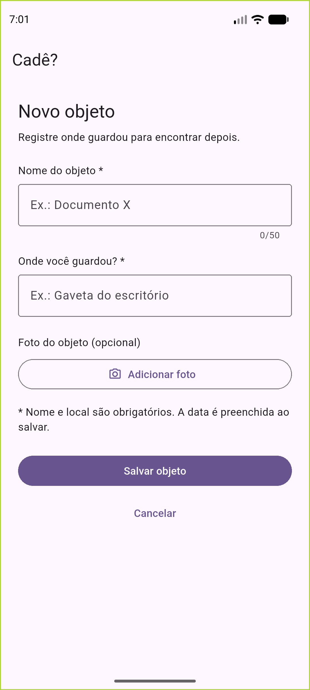

# Cadastro do Cadê — SCRUM-86

O aplicativo agora inicia no formulário **Novo objeto**, substituindo o contador de exemplo do Flutter. Esta entrega conecta a tela às camadas existentes; não implementa as telas de busca, detalhes ou edição.

## O que o usuário pode fazer

- Informar nome e local, ambos obrigatórios. O nome aceita até 50 caracteres visíveis.
- Salvar sem foto. O banco preenche a data automaticamente.
- Ler a explicação da câmera antes de solicitar permissão, adicionar uma foto e removê-la antes de salvar.
- Continuar com nome e local se não quiser foto ou negar a câmera.
- Salvar no aparelho e receber confirmação; o formulário é limpo para o próximo cadastro.
- Cancelar para limpar os dados ainda não salvos. Em falha de salvamento, os campos são preservados.

## Explicação da inicialização

Em [main.dart](../lib/main.dart):

1. O import de `flutter/widgets.dart` disponibiliza a inicialização do Flutter e `runApp`.
2. Os demais imports trazem a raiz do app, o banco e o serviço de mídias.
3. `Future<void> main() async` permite aguardar a criação das pastas de mídia.
4. `WidgetsFlutterBinding.ensureInitialized()` prepara os plugins antes de acessá-los.
5. `await MidiaService.criar()` prepara os arquivos de mídia uma única vez.
6. `runApp(CadeApp(...))` entrega o banco e o serviço à raiz do Cadê, substituindo `MyApp` e o contador demonstrativo.

## Injeção de dependências

Em [app.dart](../lib/app.dart), `CadeApp` recebe banco e mídias no construtor. Seu estado mantém o tempo de vida desses recursos; `dispose` solicita o fechamento do banco e do gravador. `unawaited` permite iniciar essa liberação, pois o método `dispose` do Flutter não é assíncrono.

`MultiProvider` organiza as dependências na ordem em que são necessárias:

| Registro | Por que existe |
|---|---|
| `Provider<CadeDatabase>.value` | Disponibiliza o banco já recebido pelo app |
| `Provider<MidiaService>.value` | Reutiliza o serviço de mídias inicializado antes de `runApp` |
| `Provider<PermissaoService>` | Disponibiliza as solicitações de permissão, sem pedi-las na abertura |
| `Provider<CategoriaRepository>` | Conecta categorias ao banco |
| `Provider<LocalRepository>` | Conecta locais ao banco e às mídias |
| `Provider<ObjetoRepository>` | Conecta o cadastro de objetos ao banco, às mídias e às categorias |
| `ChangeNotifierProvider<RegistrarViewModel>` | Cria o estado do formulário e chama `iniciar` para carregar os dados de apoio |

`context.read()` obtém as dependências sem observar suas mudanças. `MaterialApp` define o título, mantém a cor-base roxa que já existia no projeto e abre `RegistrarView`. A arquitetura continua MVVM com repositories e services.

## Explicação do formulário

Em [registrar_view.dart](../lib/ui/registrar/registrar_view.dart):

- `_formulario` identifica o `Form`; `_nome` e `_local` controlam o texto exibido. Os controllers são liberados em `dispose`.
- `context.watch<RegistrarViewModel>()` reconstrói a tela quando o estado muda; a View não consulta SQL nem chama repositories diretamente.
- `SingleChildScrollView` permite rolar quando a tela é curta ou o teclado aparece. `ConstrainedBox` limita a largura em telas grandes.
- Os rótulos ficam acima dos campos para poderem quebrar linha com fontes ampliadas. `Semantics` identifica os campos obrigatórios para leitores de tela.
- `maxLength` limita a entrada do nome; `validator` delega as regras ao ViewModel. `onChanged` mantém o estado do formulário sincronizado com o texto digitado.
- A ação “próximo” do teclado leva ao local. A ação “concluído” chama o mesmo salvamento do botão.
- `_salvar` valida o formulário, oculta o teclado e aguarda `salvar` do ViewModel. Só limpa e mostra confirmação quando o retorno é verdadeiro.
- `_limpar` pede ao ViewModel que descarte dados e mídias pendentes e depois limpa os campos e as mensagens de validação.
- `_tirarFoto` mostra a justificativa e só chama o ViewModel após “Usar câmera”. “Agora não” fecha o diálogo sem pedir permissão.
- `Image.file` mostra a foto pelo caminho fornecido pelo ViewModel, com alternativa caso o arquivo não possa ser lido. A tela não monta caminhos internos de armazenamento.
- O aviso de permissão negada explica que o cadastro continua por texto. Se a negação for permanente, há acesso às configurações.
- Durante salvamento, câmera ou limpeza, os controles ficam desabilitados. `PopScope` impede sair enquanto essas operações estão em andamento.

## Ajustes no ViewModel

Em [registrar_view_model.dart](../lib/ui/registrar/registrar_view_model.dart):

- `limiteNome` centraliza o limite de 50 caracteres para a tela e para a validação.
- `validarNome` rejeita texto vazio, somente espaços ou acima do limite. `characters` conta caracteres visíveis, inclusive emojis, da mesma forma que o campo do Flutter.
- `validarLocal` rejeita texto vazio ou só com espaços. `podeSalvar` usa essas validações e os estados de gravação/salvamento.
- `caminhoFotoObjeto` resolve o caminho por meio do serviço de mídia, mantendo esse conhecimento fora da View.
- O `try` de `_fotografar` agora também cobre falhas ao solicitar a permissão.
- `limparFormulario` limpa campos, categoria, avisos e mídias pendentes. O salvamento existente já retira dessas referências as mídias que passaram a pertencer ao registro; por isso elas não são apagadas ao limpar o formulário após sucesso.

## Dependências e plataformas

- `provider` foi declarado no `pubspec.yaml`, conforme já previsto no README. Sua dependência `nested` foi adicionada ao lockfile.
- `characters`, já presente como dependência transitiva do Flutter, passou a ser declarado diretamente porque o ViewModel o utiliza.
- O manifesto Android declara `CAMERA`. `android.hardware.camera` é opcional para não exigir câmera em aparelhos que usarão apenas texto.
- O `Info.plist` do iOS recebeu a descrição do uso da câmera. A compilação e a autorização no iOS não foram testadas neste ambiente Windows.
- Não foi adicionada solicitação de microfone à tela do MVP.

## Validação realizada

O teste antigo do contador foi substituído por testes do cadastro:

| Teste | O que comprova |
|---|---|
| Campos vazios | A tela mostra os avisos e não grava um registro incompleto |
| Cadastro sem foto | Nome e local são gravados no SQLite real em memória; há data automática e o formulário é limpo |
| Explicação da câmera | O usuário pode desistir antes de solicitar permissão |
| Tela estreita | O formulário e os rótulos cabem com largura de 320 e escala de texto 2 |
| Somente espaços | O ViewModel impede salvar sem nome ou local válidos |
| Limite do nome | Aceita 50 caracteres visíveis, inclusive emojis, e rejeita 51 |
| Falha no banco | Uma falha real de escrita preserva os campos e apresenta mensagem de erro |

Os testes usam SQLite real e substituem o serviço de mídias, evitando depender de câmera ou microfone para validar o formulário. A compilação Android e a tela no emulador também foram conferidas. Um registro de validação foi salvo pela tela, consultado no banco do aparelho e conferido após encerrar e iniciar novamente o processo. O objeto e o local criados para essa conferência foram removidos pelos repositories do app.

## Situação da entrega

A implementação está na branch `feature/SCRUM-86-tela-cadastro`, criada da `develop` depois do merge do protótipo. Commit, push e PR desta implementação dependem da aprovação do solicitante. O resultado do CI remoto desta mudança só poderá ser conferido após sua publicação.

A preparação e seus documentos têm evidências registradas no Jira e estão em análise. A confirmação de execução no ambiente do outro integrante e a revisão dele não foram comprovadas. O SCRUM-86 e sua história de cadastro permanecem em andamento até a revisão e publicação desta implementação. A meta de quantidade de toques e os testes com usuários não são comprovados pelos testes automatizados.
