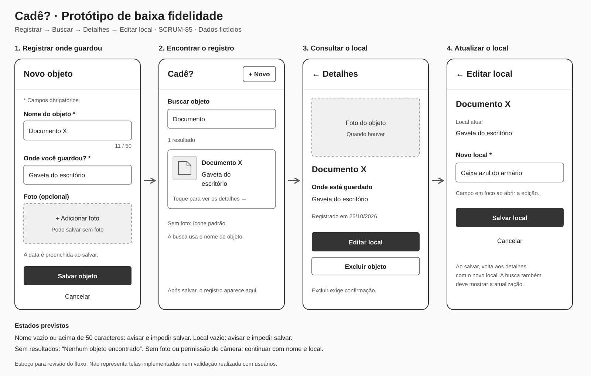

# Protótipo de baixa fidelidade (SCRUM-85)

Este esboço atende ao fluxo registrar → buscar → editar solicitado no [SCRUM-77](https://cade-system.atlassian.net/browse/SCRUM-77) e na subtarefa [SCRUM-85](https://cade-system.atlassian.net/browse/SCRUM-85). A tela de detalhes é intermediária porque os critérios de edição do local partem dela.

- [Abrir imagem SVG](prototipo-cade.svg)
- [Abrir PDF para revisão e anexo no Jira](prototipo-cade.pdf)
- [Consultar a estrutura de dados](estrutura-de-dados.md)

## Base consultada

Os documentos Word, PDFs e o ZIP do Confluence na pasta de materiais do projeto contêm a proposta, o planejamento e referências aos mockups esperados. Não foi encontrado um protótipo pronto nos materiais consultados. Este esboço foi elaborado a partir dos critérios das histórias, sem reproduzir uma interface existente.

O desenho usa apenas tons de cinza e campos simples para discutir o fluxo. As cores, os componentes finais e o comportamento responsivo serão definidos durante a implementação conforme o padrão do projeto. Nomes, locais e data exibidos são exemplos fictícios.

## Fluxo proposto

| Tela | Ações e informações | Critérios relacionados |
|---|---|---|
| Novo objeto | Nome obrigatório, até 50 caracteres; local obrigatório; foto opcional; data automática; salvar ou cancelar | [SCRUM-78](https://cade-system.atlassian.net/browse/SCRUM-78), [SCRUM-79](https://cade-system.atlassian.net/browse/SCRUM-79) e orientação registrada no SCRUM-84 |
| Buscar | Pesquisa por nome; resultado com nome, local e miniatura ou ícone padrão; acesso ao cadastro por “Novo” | [SCRUM-17](https://cade-system.atlassian.net/browse/SCRUM-17) e [SCRUM-18](https://cade-system.atlassian.net/browse/SCRUM-18) |
| Detalhes | Foto quando houver, nome, local e data; voltar à busca; ações de editar local e excluir | [SCRUM-19](https://cade-system.atlassian.net/browse/SCRUM-19) |
| Editar local | Mostrar o local atual; abrir o novo local em foco; salvar ou cancelar | [SCRUM-20](https://cade-system.atlassian.net/browse/SCRUM-20) |

Exemplo: registrar `Documento X` em `Gaveta do escritório`, localizar por `Documento`, abrir os detalhes e atualizar para `Caixa azul do armário`.

Após salvar o cadastro, a busca deve mostrar o registro. Depois de salvar a mudança de local, os detalhes e a busca devem mostrar o novo valor. Cancelar não deve gravar as alterações.

## Estados e regras para implementar

- Nome vazio, só com espaços ou acima de 50 caracteres: explicar o problema e impedir salvar.
- Local vazio ou só com espaços, no cadastro ou na edição: explicar o problema e impedir salvar. Essa é a orientação atual registrada na [estrutura de dados](estrutura-de-dados.md), já alinhada ao critério do SCRUM-79.
- Foto ausente ou câmera negada: permitir continuar com nome e local. A explicação da permissão deve preceder a solicitação, feita apenas ao usar a câmera, conforme o SCRUM-82.
- Sem resultados: mostrar “Nenhum objeto encontrado”. A busca deve ignorar maiúsculas/minúsculas e acentos, conforme o SCRUM-17; o desenho não comprova essa implementação.
- Excluir exige confirmação, conforme a história de exclusão. O diálogo não está detalhado neste esboço do fluxo principal.
- Ao salvar, evitar envios duplicados e informar se a operação falhar, preservando os dados preenchidos.

## Metas e validação pendentes

O planejamento prevê cadastro com poucos toques e edição do local a partir dos detalhes em até dois toques. O desenho propõe abrir o campo de edição já em foco para reduzir interações; a quantidade de toques, o tempo de digitação e a usabilidade precisam ser medidos no aplicativo. O protótipo não comprova o cumprimento dessas metas.

Áudio, backup e filtros por categoria não foram incluídos no fluxo do MVP deste esboço. Os campos já existentes no código não significam que esses recursos estejam entregues.

O SVG é a fonte editável do desenho e o PDF é sua versão para compartilhar. O protótipo foi aprovado pelo solicitante, publicado e integrado à `develop` no PR #4; o PDF foi anexado ao SCRUM-85. A revisão pelo outro integrante e a validação com usuários ainda não foram comprovadas. As telas são implementadas nos respectivos cards; o desenho não comprova a entrega do fluxo completo.
